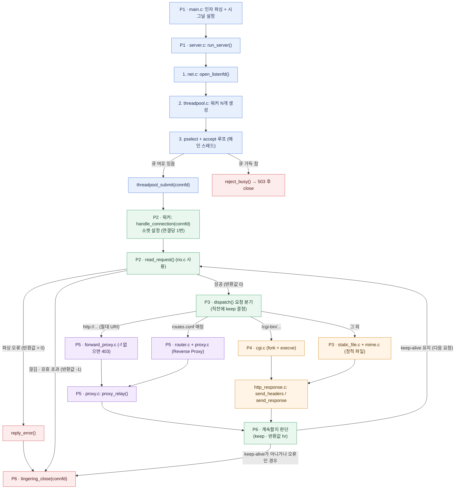
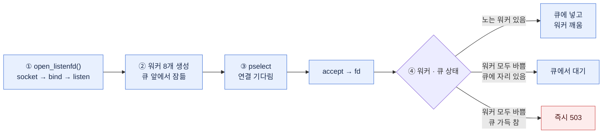
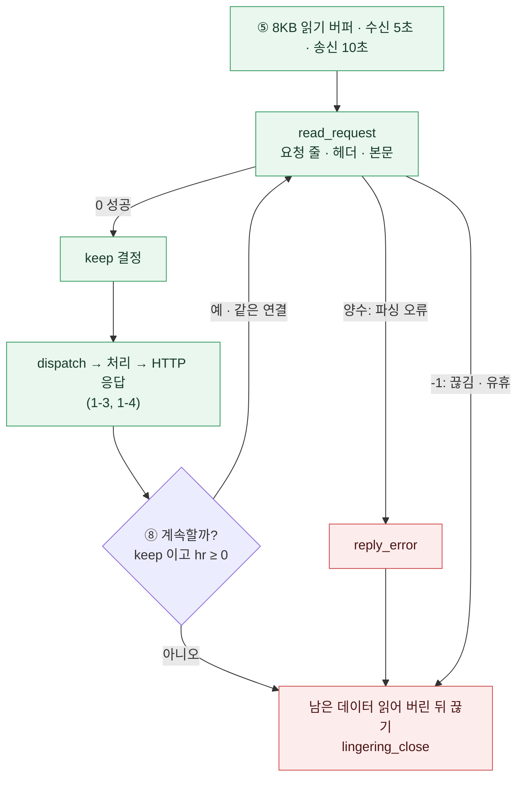
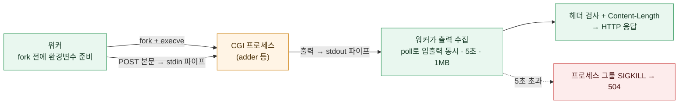
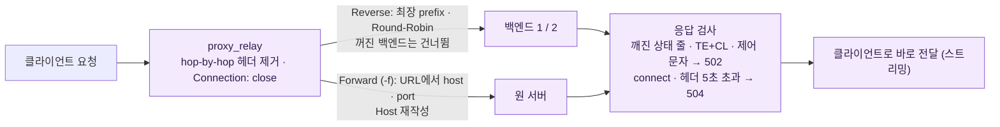
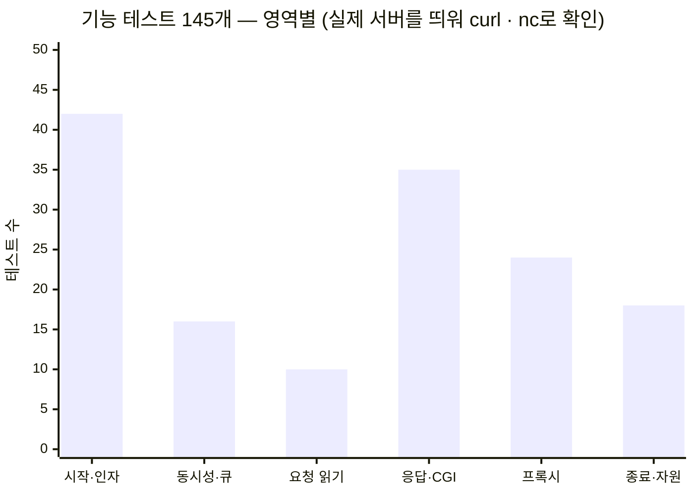
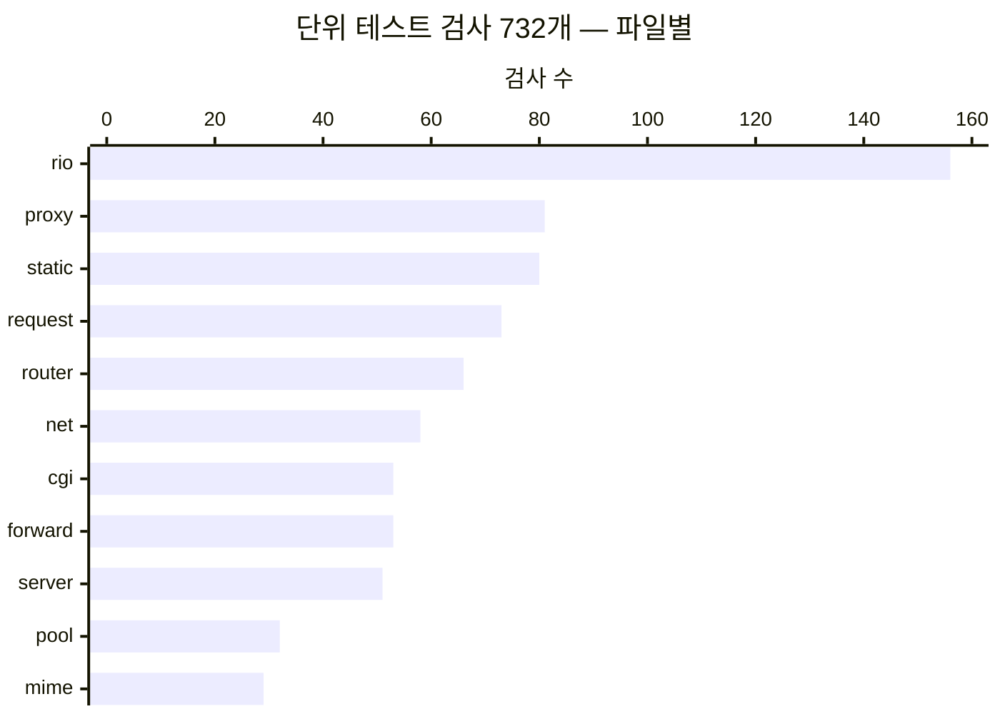
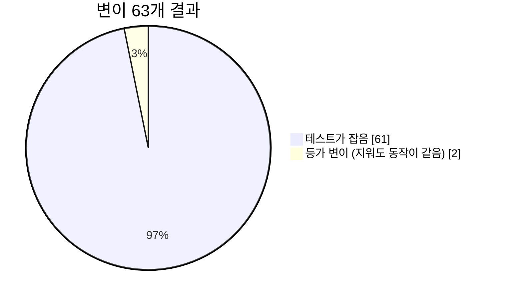
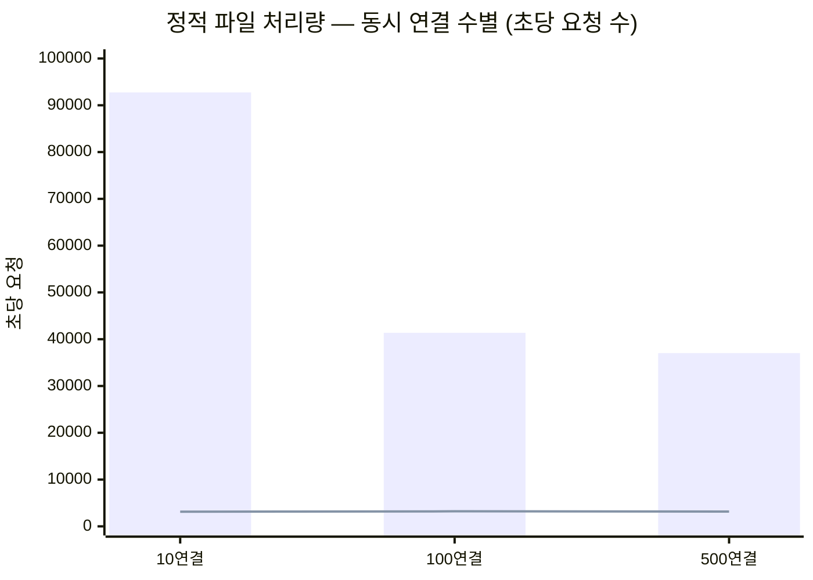
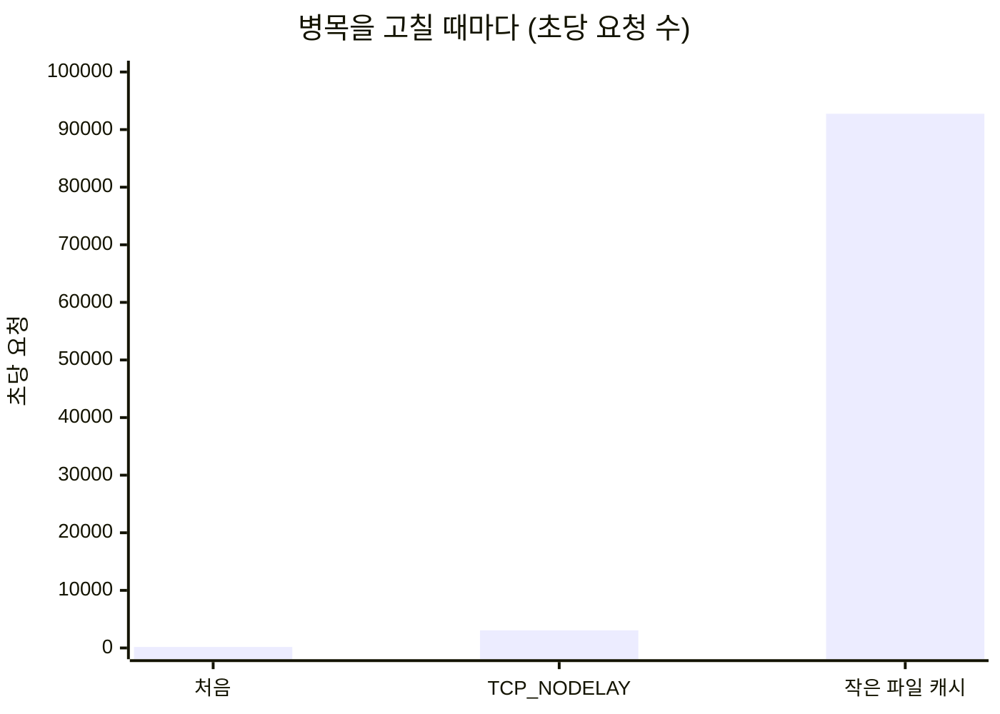

# SW-AI-W13-WEB-SERVER

POSIX 소켓 API만으로 만든 C 웹서버 (WEEK13 · 11팀)
정적 파일 · CGI · 스레드 풀 · Reverse Proxy · Forward Proxy

| 기능 테스트 | 단위 테스트 | 메모리 | 변이 테스트 | 정적 파일 처리량 |
|:---:|:---:|:---:|:---:|:---:|
| **145 / 145** | **약 730개 통과** | **오류 0 · 누수 0** | **61 / 63 검출** | **초당 92,750건** |

**발표 순서**: [1. 구조와 설계 선택](#1-구조와-설계-선택) → [2. 검증](#2-검증) → [3. 회고](#3-회고)
파트별 상세 설명과 테스트 목록은 [상세 문서](#상세-문서)에 있습니다.

---

## 1. 구조와 설계 선택

### 1-0. 전체 흐름



아래에서 이 그림을 네 부분으로 나눠 확대해 봅니다.

### 1-1. 서버 시작과 연결 받기 (메인 스레드)



| 순서 | 어디서 | 무엇을 | 왜 이렇게 |
|---|---|---|---|
| ① | `run_server` → `net.c` `open_listenfd()` | `socket` → `bind`(주소·포트) → `listen`. 이후 커널이 연결을 완성해 **커널 대기 큐**에 쌓음 | |
| ② | `threadpool.c` | **워커 스레드 8개를 미리 생성** (`-t`로 조절). 워커는 클라이언트와 HTTP 요청·응답을 주고받고, 처리할 연결이 없으면 큐 앞에서 잠듦 | 요청마다 스레드를 만들면 생성 비용이 들고, 몰리면 스레드가 끝없이 늘어나 서버가 죽을 수 있음 |
| ③ | 메인 스레드 | `pselect`로 기다림 → `accept` → 큐에 넣고 워커 하나 깨움 → 다음 연결 대기 | 직접 처리하면 그동안 새 연결을 받을 수 없음 |
| ④ | 큐 | 워커가 모두 바쁘고 큐에 자리가 있으면 **큐에서 대기**, 큐까지 가득 차면 **즉시 503** | 몰려도 서버가 멈추지 않게 |

### 1-2. 연결 하나 처리하기 (워커 · `handle_connection`)



| 순서 | 어디서 | 무엇을 | 왜 이렇게 |
|---|---|---|---|
| ⑤ | `handle_connection` | 8KB 읽기 버퍼 준비 → **수신 5초 · 송신 10초** 제한 → `read_request`로 요청 줄·헤더·본문 읽고 검사 | 보내지 않거나 받아 가지 않는 클라이언트에 워커가 묶이지 않게 |
| ⑥ | 모든 처리 함수 | 리턴값 통일: **`0` 성공 · 양수 = 보낼 HTTP 오류 코드 · `-1` 연결 끊기** | 오류 응답을 `handle_connection` 한 곳에서만 보냄 |
| ⑧ | 응답 뒤 | keep-alive면 같은 연결로 다음 요청, 아니면 **남은 데이터를 읽어 버린 뒤** 연결 끊기 | 읽지 않은 데이터가 남은 채로 끊으면 커널이 강제 종료(RST)를 보내 클라이언트가 방금 받은 HTTP 응답까지 버릴 수 있음 |

### 1-3. 분기 ⑦ — CGI (`cgi.c`)



| 순서 | 어디서 | 무엇을 | 왜 이렇게 |
|---|---|---|---|
| ⑦ | `dispatch` | 절대 URL → Forward / 설정 경로 → Reverse / `cgi-bin` → CGI / 그 외 → 정적 파일. **CGI 출력은 파이프로 서버가 먼저 받음** | 서버가 확인하고 `Content-Length`를 붙여야 연결을 이어 쓸 수 있고, 이상한 출력을 502로 막을 수 있음 |

### 1-4. 분기 ⑦ — Reverse · Forward Proxy (`proxy_relay`)



| 순서 | 어디서 | 무엇을 | 왜 이렇게 |
|---|---|---|---|
| ⑦ | `router.c` · `proxy.c` · `forward_proxy.c` | **Reverse**: 경로가 가장 길게 일치하는 규칙의 백엔드로 Round-Robin, 꺼진 백엔드는 건너뜀. **Forward** (`-f`): URL에서 접속할 곳을 꺼내 원 서버에는 경로만 보냄. 둘 다 같은 `proxy_relay`로 응답을 검사해 전달 | 백엔드가 이상한 응답을 보내도 클라이언트 쪽 연결이 깨지지 않게 (502), 멈춘 백엔드에 워커가 묶이지 않게 (504) |

---

## 2. 검증

> AI로 빠르게 만든 만큼, 구조의 파트마다 **무엇을 어떻게 깨뜨려 봤는지**를 테스트로 남겼습니다.

| 검증 | 결과 |
|---|---|
| 기능 테스트 (`tests/functional.sh`, 실제 서버 + curl/nc) | **145 / 145 통과** (일반 빌드 · ASan 빌드 모두) |
| 단위 테스트 (`tests/test_*.c` 11개 파일) | **검사 약 730개 전부 통과** (일반 · ASan/UBSan) |
| 메모리 (ASan · valgrind, 실제 서버 시나리오) | **오류 0 · 누수 0** |
| 테스트 자체 검증 (변이 테스트) | **63개 중 61개 검출** · 남은 2개는 동작이 같은 등가 변이 |
| 부하 (wrk, 정적 파일, 동시 10연결) | **초당 92,750건** · 평균 0.09ms |

직접 돌려 보려면 [빌드 · 실행](#빌드--실행)의 `make test` · `tests/functional.sh` · `tests/load.sh`를 실행하면 됩니다.

### 2-1. 테스트를 어디에 얼마나 했나





### 2-2. 테스트가 버그를 잡는지도 검증 (변이 테스트)

코드에 일부러 버그를 넣었을 때(검사 한 줄 삭제, 조건 뒤집기, 원자 연산 제거 …) 테스트가 실패하는지 확인했습니다.



| 영역 | 변이 수 | 검출 | 놓친 것 |
|---|:---:|:---:|---|
| 서버 코어 (rio · net · server · main) | 24 | 23 | `pselect` EINTR 처리: 등가 변이 |
| CGI | 13 | 12 | 입력 파이프를 닫는 시점: 등가 변이 |
| Reverse Proxy | 15 | 15 | |
| Forward Proxy | 11 | 11 | |

처음엔 SIGPIPE 무시 설정을 지워도 **아무 테스트도 실패하지 않았습니다** → 20MB 응답 도중 끊는 테스트를 추가해 잡도록 고쳤습니다.

### 2-3. 이렇게 깨뜨려 봤습니다

대표 사례입니다. 전체 목록은 [상세 문서](#상세-문서)에 있습니다.

| 파트 | 시도 | 결과 |
|---|---|---|
| 요청 읽기 | 1초에 1바이트씩 보내는 slowloris / 깨진 요청·20KB 헤더·100KB 쓰레기 바이트 | **408** / 서버가 죽지 않고 다음 요청 정상 처리 |
| 정적 파일 | `/../Makefile`, 루트 밖을 가리키는 심볼릭 링크 | **403**, 내용 노출 없음 |
| CGI | 5초 넘게 멈춤 / 512KB POST 본문 (파이프 버퍼보다 큼) | **504** + CGI가 띄운 자식까지 종료 / 교착 없음 |
| 프록시 | 가짜 백엔드가 깨진 응답 17가지를 보냄 / 응답 없음 | 모두 **502** / **504** |
| 큐 · 종료 | 워커·큐가 모두 찬 상태 / Ctrl+C | **즉시 503** / 처리 중인 요청을 마치고 1초 안에 `exit 0` |

### 2-4. 성능 (wrk, 10초, keep-alive, 워커 8개)



막대 = 작은 파일 캐시 적용 후 · 선 = 적용 전. 동시 연결이 늘면 연결 하나가 기다리는 시간이 늘어 처리량이 줄지만, **동시 500연결에서도 503 · 소켓 오류 0건**입니다.

| 동시 연결 | 초당 요청 | 평균 지연 |
|:---:|:---:|:---:|
| 10 | **92,750** | 0.09ms |
| 100 | 41,368 | 2.0ms |
| 500 | 37,024 | 13ms |


CGI는 요청마다 프로세스를 새로 만들고(`fork` + `execve`), 프록시는 백엔드와 연결을 하나 더 맺기 때문에 정적 파일보다 느립니다.

**측정으로 찾아 고친 병목** (정적 파일, 동시 10연결)



| 단계 | 원인 | 해결 | 초당 요청 |
|---|---|---|:---:|
| 처음 | 헤더·본문을 두 번 write → Nagle 알고리즘과 상대의 지연 ACK가 맞물려 요청마다 약 40ms 정지 | `TCP_NODELAY` | 173 → 3,058 |
| 2단계 | WSL `/mnt/c`(9P)에서 `realpath`·`open`이 각 1.6ms → 요청당 파일 시스템 3.7ms | 64KB 이하 파일을 1초 메모리 캐시 | 3,058 → **92,750** |

---

## 3. 회고

**만들고 나서야 보인 것: Forward Proxy**

처음에는 Reverse와 Forward 프록시 둘 다 장점이 있으니 구현하면 좋겠다는 생각으로 모두 만들었습니다. 하지만 만들고 보니 요즘 웹은 대부분 HTTPS라, CONNECT 터널링과 캐싱이 없는 Forward 프록시는 Reverse만큼 실전에서 쓸모가 크지 않았습니다.

| | Reverse Proxy | Forward Proxy |
|---|---|---|
| 누구 편 | 서버 쪽 (사이트 운영자) | 클라이언트 쪽 |
| HTTPS일 때 | 사이트 인증서를 가지고 있어 **직접 복호화**(TLS 종료)한 뒤 분배 가능 | 남의 사이트 인증서가 없어 내용을 볼 수 없음 → CONNECT 터널로 바이트만 넘김 |
| 이 서버에서 | 라우팅 · 분산 · 장애 백엔드 건너뛰기로 실제 역할이 있음 | `http://`만 처리 → 활용처가 거의 없음 |

→ **장점만 보고 기능을 추가하기보다, 실제로 어디에 어떻게 쓰일지 먼저 설계하는 게 중요하다**는 점을 배웠습니다.
만들며 넣은 connect 5초 제한과 공통 응답 검사는 Reverse Proxy에도 그대로 쓰여, 결과물이 헛되지는 않았습니다.

**검증에서 배운 것**

- AI가 만든 코드도, AI가 한 리뷰도 그대로 믿지 않고 하나씩 **재현**했습니다. 재현되는 것만 고치고 나머지는 근거를 남겼습니다. ([예시](#전체에-걸친-검증))
- 테스트가 통과해도 그 테스트가 버그를 잡는지는 따로 확인해야 했습니다. 변이 테스트로 SIGPIPE 처리를 지워도 아무 테스트가 실패하지 않는 빈틈을 찾았습니다.

---

## 상세 문서

| 파트 | 범위 | 핵심 파일 |
|---|---|---|
| [Part 1](#part-1-서버-시작과-연결-받기) | 서버 시작 · 포트 열기 · 워커 생성 · `pselect` + `accept` · 큐 / 503 | `main.c` `server.c` `net.c` `threadpool.c` |
| [Part 2](#part-2-요청-읽기) | 연결 설정 · 요청 하나 읽고 검사 · 파싱 오류 응답 | `server.c` `http_request.c` `rio.c` |
| [Part 3](#part-3-요청-분기와-정적-파일) | keep 결정 · 분기 · 정적 파일 · MIME · 캐시 | `server.c` `static_file.c` `mime.c` `http_response.c` |
| [Part 4](#part-4-cgi) | CGI 실행 · 입출력 · 시간·크기 제한 | `cgi.c` `cgi-bin/adder.c` |
| [Part 5](#part-5-reverse-proxy--forward-proxy) | 라우팅 · Round-Robin · 중계 · 502/504 · Forward | `router.c` `proxy.c` `forward_proxy.c` |
| [Part 6](#part-6-연결-유지닫기와-서버-종료) | 계속할지 판단 · 연결 닫기 · SIGINT/SIGTERM 종료 | `server.c` `main.c` |

**공통 반환 규칙**: 요청 파서와 모든 핸들러는 같은 규칙으로 값을 돌려줍니다.
- `0`: 성공. 응답을 이미 보냈습니다.
- `> 0`: 보낼 HTTP 오류 코드(400, 404, 502 …). 아직 아무것도 보내지 않았고, 오류 응답은 `handle_connection` 한 곳에서만 보냅니다.
- `-1`: 연결을 닫아야 합니다. 응답 없이 닫습니다.

---

## 빌드 · 실행

WSL2(Ubuntu) / Linux. `tests/functional.sh`는 `/proc`·`ss`를 써서 Linux/WSL 전용입니다.

```bash
make            # bin/server, cgi-bin/adder
make test       # 단위 테스트
make asan       # AddressSanitizer + UBSan으로 빌드 후 단위 테스트
bash tests/functional.sh                          # 기능 테스트 (실제 서버)
SERVER=build/asan/server bash tests/functional.sh # ASan 서버로 기능 테스트
bash tests/load.sh                                # 부하 테스트 (wrk)
```

```bash
./bin/server -p 8080 -r ./www                          # 웹서버
./bin/server -p 8080 -r ./www -c conf/routes.conf      # + Reverse Proxy
./bin/server -p 8080 -r ./www -f                       # + Forward Proxy

curl http://127.0.0.1:8080/                                   # 정적 파일
curl "http://127.0.0.1:8080/cgi-bin/adder?a=1&b=2"            # CGI GET  → 1 + 2 = 3
curl -d 'a=40&b=2' http://127.0.0.1:8080/cgi-bin/adder         # CGI POST → 40 + 2 = 42
curl http://127.0.0.1:8080/api/index.html                      # Reverse (routes.conf의 /api/)
curl -x 127.0.0.1:8080 http://127.0.0.1:8001/index.html        # Forward
```

| 옵션 | 기본값 | 의미 |
|---|---|---|
| `-p` | 8080 | 포트 |
| `-r` | ./www | 정적 파일 루트 |
| `-g` | ./cgi-bin | CGI 폴더 |
| `-c` | 없음 | 라우팅 설정 파일 (지정하면 Reverse Proxy 동작) |
| `-f` | 꺼짐 | Forward Proxy 허용 |
| `-t` | 8 | 워커 스레드 수 |
| `-q` | 1024 | 연결 대기 큐 크기 (차면 503) |

---

## Part 1. 서버 시작과 연결 받기

`main.c` → `run_server()` → `open_listenfd()` → 워커 생성 → `pselect` + `accept` 루프

**동작**
- `main`이 옵션을 검사합니다. 잘못된 값이면 시작하지 않고 `exit 1`입니다.
- 시그널을 설정합니다.
  - SIGPIPE는 무시합니다. 끊긴 소켓에 쓸 때 서버 전체가 죽지 않게 하기 위해서입니다.
  - SIGINT·SIGTERM은 "종료하라"는 표시만 세웁니다.
- `run_server`는 아래 세 가지를 **순서대로** 실행합니다.
  1. `open_listenfd`: `socket` → `SO_REUSEADDR` → `bind` → `listen(1024)`. 이때부터 커널이 연결을 완성해 대기열에 쌓습니다.
  2. 워커 생성: 워커 N개를 미리 만듭니다. 할 일이 없으면 큐 앞에서 `pthread_cond_wait`로 잠듭니다.
  3. `pselect` + `accept` 루프: 메인 스레드는 연결을 받아 fd를 큐에 넣는 일만 합니다. 직접 처리하면 그동안 새 연결을 못 받기 때문입니다.
- 큐(기본 1024칸)까지 가득 차면 기다리지 않고 **503**을 보내고 닫습니다. 메인 스레드가 멈추면 서버 전체가 멈추기 때문입니다.
- SIGINT·SIGTERM은 평소에는 막아 두고 `pselect`가 기다리는 동안에만 풉니다.
  - 확인하고 잠드는 사이에 시그널이 와서 종료가 늦어지는 경쟁 조건이 없습니다.
  - 워커는 시그널을 받지 않습니다.
- fd 한도(EMFILE)에 걸리면 100ms 쉽니다. 처리 못 한 연결 때문에 `pselect`가 계속 깨어나며 CPU를 100% 쓰는 것을 막습니다.

**검증**

| 무엇을 | 어떻게 | 결과 |
|---|---|---|
| 잘못된 인자 거부 | `-p 0` `-p 70000` `-p +80` `-p ' 80'` `-t 0` `-t 1025` `-q abc` 등 30가지를 실제로 실행 | 모두 `exit 1`, 유효한 값 8가지는 실행 유지 |
| 포트 처리 | 이미 쓰는 포트로 두 번째 실행 / 종료 직후 TIME_WAIT 상태에서 재시작 | 충돌은 `exit 1`, 재시작은 성공 (`SO_REUSEADDR`) |
| 큐 포화 | 워커 1개 · 큐 1칸으로 띄운 뒤 연결을 붙잡아 둠 | 503이 **기다리지 않고** 즉시 도착, 풀리면 다시 200 |
| 시그널 받는 스레드 | `/proc/<pid>/task/*/status`의 `SigBlk` 확인 | 메인만 SIGINT/SIGTERM 허용, 워커 8개는 모두 막힘 |
| fd 한도 | `ulimit -n 64`에서 연결 90개로 fd를 바닥냄 | 서버 생존, 1초 동안 CPU 0~1%, fd가 돌아오면 다시 200 |
| 스레드 풀 | 동시 submit, 큐 가득 참, 종료 시 남은 작업 처리 (`test_threadpool`) | 20회 반복 실행 모두 통과 |
| 네트워크 도우미 | 포트 문자열 경계값(`""` `65536` `+80`), bind 실패, CLOEXEC (`test_net`) | 통과 |

---

## Part 2. 요청 읽기

`handle_connection()` → `read_request()` (`rio.c`) → 파싱 오류면 `reply_error()`

**동작**
- 워커는 연결 하나를 맡으면 소켓 규칙을 **연결당 한 번** 정합니다.
  - 수신 5초: 아무것도 보내지 않는 클라이언트를 정리합니다.
  - 송신 10초: 응답을 받아 가지 않는 클라이언트를 정리합니다.
  - `TCP_NODELAY`: 작은 응답도 지연 없이 보냅니다.
- `rio`(CSAPP Robust I/O)는 소켓 바이트를 8KB 버퍼에 받아 두고 줄 단위(`rio_readlineb`)나 n바이트 단위(`rio_readnb`)로 꺼냅니다. TCP는 한 번의 `read`가 반 줄만 주거나 요청 두 개를 붙여 줄 수 있기 때문에 이렇게 처리합니다.
- `read_request`는 요청 줄 → 헤더(빈 줄까지) → 본문(`Content-Length`만큼) 순서로 읽고 검사합니다.

| 반환값 | 상황 | 처리 |
|---|---|---|
| `0` | 정상 요청 | Part 3으로 |
| `> 0` | 형식 오류: 400 · 405 · 408 · 411 · 413 · 414 · 431 · 501 · 505 | `reply_error`로 응답 후 닫음 (다음 요청의 경계를 믿을 수 없음) |
| `-1` | 클라이언트가 끊음 / keep-alive 상태로 5초 동안 요청 없음 | 응답 없이 닫음 |

- 요청 줄을 받은 순간부터 **요청 전체 10초** 마감이 시작됩니다. 1바이트씩 천천히 보내는 공격(slowloris)도 408로 끊깁니다.
- 보안 검사: Host 중복(400), `Transfer-Encoding` 전체 거부(501), 헤더 값 안의 제어 문자(400). 이 서버가 프록시로 요청을 넘길 때 백엔드가 요청 경계를 다르게 해석하는 요청 밀반입(request smuggling)을 막기 위해서입니다.

**검증**

| 무엇을 | 어떻게 | 결과 |
|---|---|---|
| 줄 읽기의 경계 | short count, EINTR(시그널로 끊긴 read), 마감 시각, 줄 길이 상한 (`test_rio`, 검사 약 150개) | 통과 |
| 파싱 규칙 | 상태 코드 경계값, Host 중복, `Connection: close, keep-alive` 순서, 줄 중간 CR (`test_http_request`) | 통과 |
| 비정상 클라이언트 | 요청을 조각내 보내기, LF만 쓰기, 헤더 도중 끊기, 20KB 헤더 줄, 100KB 쓰레기 바이트, 응답 안 읽고 끊기 30회 | 서버가 죽지 않고 다음 요청을 정상 처리, 431·400 정확 |
| SIGPIPE | 20MB 파일을 요청하자마자 끊기 10회 (서버가 끊긴 소켓에 계속 쓰게 됨) | 서버 생존, 다음 요청 정상 |
| 시간 제한 | 요청 줄만 보내고 멈춤 / 1초에 1바이트씩 14초 | 둘 다 **408** |
| 큰 본문 | 1MB 상한을 넘는 3MB 본문 | 413 응답이 **실제로 도착** (RST로 사라지지 않음) |

---

## Part 3. 요청 분기와 정적 파일

`dispatch()` → `static_file.c` + `mime.c` → `send_headers` / `send_response`

**동작**
- `dispatch` 직전에 **keep(응답 뒤 연결 유지 여부)**을 정합니다. 클라이언트가 원하고, 서버가 종료 중이 아니고, 큐에 기다리는 연결이 없어야 유지합니다. 응답 헤더의 `Connection` 값에 들어가야 하므로 미리 정합니다.
- 분기는 위에서부터 확인해 처음 맞는 곳으로 갑니다.
  1. `http://...` → Forward
  2. `routes.conf` prefix 일치 → Reverse
  3. `/cgi-bin/` → CGI
  4. 그 외 → 정적 파일
- 정적 파일 처리 순서
  1. `realpath`로 실제 경로를 구한 뒤 루트 안인지 확인합니다. `../`와 심볼릭 링크로 루트 밖에 나가면 403입니다.
  2. `open` 후 같은 fd로 `fstat`합니다. 확인하는 순간과 사용하는 순간 사이에 파일이 바뀌는 경쟁(TOCTOU)이 없습니다.
  3. `O_NONBLOCK`으로 엽니다. FIFO를 열 때 멈추지 않습니다.
  4. 일반 파일이 아니면 403입니다.
- 확장자로 `Content-Type`을 정합니다(20종). 모르는 확장자는 `application/octet-stream`입니다.
- **작은 파일 캐시**: 64KB 이하 파일을 워커 스레드별 메모리에 1초 동안 둡니다. 스레드별이라 락이 없고, 스레드가 끝날 때 해제합니다. 대신 파일이 바뀌어도 최대 1초 동안 이전 내용이 나갑니다.

**검증**

| 무엇을 | 어떻게 | 결과 |
|---|---|---|
| 기본 응답 | 상태 줄, `Content-Type`, `Content-Length` = 파일 크기, 본문이 파일과 바이트 단위로 같은지 | 통과 |
| 경로 탈출 | `/../Makefile`, 루트 밖을 가리키는 심볼릭 링크 | **403**, 비밀 파일 내용 노출 없음 |
| 특수 파일 | FIFO, 디렉터리, fd 한도(EMFILE) 상황 | 멈추지 않고 403 / 503 (헤더 보내기 전에 판단) |
| 큰 파일 | 64KB 버퍼 경계가 아닌 크기(약 196KB) | 원본과 바이트 동일 |
| 캐시 | 1초 안 재요청 = 이전 내용, 1초 뒤 = 새 내용, 루트가 다르면 섞이지 않음, 64KB 초과는 캐시 안 함 | 통과 |
| 성능 병목 | 시스템 콜 하나씩 시간 측정 → `/mnt/c`(9P)에서 `realpath` 1.6ms · `open` 1.7ms가 원인 | 캐시 적용 후 **초당 3,120 → 92,750건** |

---

## Part 4. CGI

`/cgi-bin/<이름>` → `serve_cgi()` (`fork` + `execve`)

**동작**
- 요청 정보는 환경변수(`REQUEST_METHOD`, `QUERY_STRING`, `CONTENT_LENGTH` …)로, POST 본문은 표준 입력 파이프로 넘깁니다.
- CGI 출력은 소켓에 바로 연결하지 않고 **파이프로 받습니다**. 서버가 헤더를 검사하고 `Content-Length`를 붙여 보내므로 keep-alive가 유지되고, 잘못된 출력은 502로 막습니다.
- 본문 쓰기와 출력 읽기를 `poll`로 **동시에** 합니다. 한쪽씩 하면 둘 다 64KB 파이프 버퍼가 찼을 때 서로를 기다리는 교착이 생기기 때문입니다.
- 멀티스레드 프로세스에서 `fork`하면, 자식은 `execve` 전까지 async-signal-safe 함수만 써야 합니다. 그래서 환경변수는 `fork` 전에 만들고, 자식은 시그널 복구 · `dup2` · `execve`만 합니다.
- 제한
  - 5초를 넘으면 **프로세스 그룹 전체**에 SIGKILL을 보내고 504입니다. CGI가 띄운 자식까지 종료합니다.
  - 출력이 1MB를 넘으면 502입니다.
  - 항상 `waitpid`로 회수합니다.

**검증** (`test_cgi`: 임시 폴더에 셸 스크립트 CGI를 만들어 실행)

| 무엇을 | 어떻게 | 결과 |
|---|---|---|
| 입력 전달 | 환경변수 값 출력, 512KB POST 본문을 그대로 돌려주기 (입출력 모두 파이프 버퍼보다 큼) | 일치, **교착 없음** |
| 잘못된 출력 | 헤더 없음, Content-Type 없음, 값 중간 CR, 비정상 종료(exit 1) | 모두 **502** |
| 제한 | 정확히 1MB = 200 / 1MB + 1바이트 = 502 / 무한 출력 / 5초 넘게 멈춤 | 경계 정확, 504가 5초 근처에 도착 |
| 자원 정리 | 실행 전후 fd 개수, `waitpid(-1)` = ECHILD, 시간 초과 CGI가 띄운 `sleep` 생존 여부 | fd·좀비 누수 0, 자식까지 종료 |
| 격리 | CGI 안에서 자기 fd 목록을 출력해 서버 소켓이 새는지 확인 | 소켓 0개 (모든 fd에 CLOEXEC) |
| 시그널 | 워커처럼 SIGINT를 막은 스레드에서 실행 → CGI의 `SigBlk` / `SigIgn` 확인 | 기본값으로 복구됨 |
| 예제 `adder` | 정상, 음수, 항목 개수 오류, 정수가 아님, 덧셈 오버플로, 잘못된 `CONTENT_LENGTH` | 200 / 400 정확 |

---

## Part 5. Reverse Proxy · Forward Proxy

`router.c` (라우팅) · `proxy.c` (공통 중계 `proxy_relay`) · `forward_proxy.c`

**동작**
- **Reverse** (`-c routes.conf`)
  - 경로가 **가장 길게 일치하는** 규칙을 고릅니다. 규칙 안의 백엔드는 Round-Robin으로 돌아가며 씁니다. 카운터를 원자적으로 증가시키므로 락이 없습니다.
  - 연결이 안 되는 백엔드는 건너뛰고, 모두 안 되면 502입니다.
- **Forward** (`-f`)
  - `GET http://host:port/path`에서 접속할 곳을 꺼냅니다. 원 서버에는 **경로만** 보내고, `Host`는 URL 기준으로 바꿉니다.
  - `user@host`처럼 접속 호스트를 속이는 URL은 400입니다.
  - `-f`가 없으면 403입니다. 의도치 않게 열린 프록시가 되지 않게 하기 위해서입니다.
- **공통 `proxy_relay`**
  - 한 구간에만 의미 있는 헤더(`Connection`, `Keep-Alive`, `Proxy-Authorization` …)는 넘기지 않습니다.
  - 백엔드 응답을 검사합니다. 상태 줄 형식, 제어 문자, `Transfer-Encoding`과 `Content-Length` 동시 존재, 값이 다른 중복 `Content-Length`가 걸리면 **502**입니다.
  - 응답 길이를 알면 클라이언트 keep-alive를 유지하고, 모르면 끝까지 보낸 뒤 닫습니다.
  - 본문은 받는 즉시 넘깁니다(스트리밍).
- **시간 제한**
  - `connect` 5초: non-blocking으로 연결하고 `poll`로 기다립니다.
  - 응답 헤더 전체 5초: 헤더를 1바이트씩 흘려 보내는 백엔드도 이 제한에 걸립니다.
  - 넘으면 **504**입니다.

**검증** (`test_proxy`: 스레드로 띄운 **가짜 백엔드**가 정해진 바이트를 응답)

| 무엇을 | 어떻게 | 결과 |
|---|---|---|
| 요청 다시 쓰기 | 백엔드가 받은 요청 원문 확인: hop-by-hop 제거, `Connection: close`, Host 처리, 300KB POST 본문 | 일치 |
| 응답 검증 | 깨진 상태 줄 · `200abc` · 1xx · TE+CL · 값 중간 CR · 64KB 초과 헤더 등 17가지 | 모두 **502**, 클라이언트에 아무것도 안 보냄 |
| 시간 제한 | 응답 없는 백엔드 / 헤더를 1바이트씩 흘림 / SYN을 버리는 호스트(듣기 큐를 꽉 채워 재현) | **504**가 5초 근처에 도착 |
| 장애 백엔드 | 꺼진 백엔드 + 정상 백엔드, 여러 스레드 동시 요청 | 502 없이 정상 백엔드로 |
| Round-Robin | 8개 스레드로 80만 번 호출 | 정확히 균등 분배 (원자적 카운터) |
| 라우팅 설정 | 최장 prefix, IPv6, 주석, 중복 prefix, 포트 범위, 줄 번호 출력 (`test_router`) | 통과 |
| URI 파싱 | 기본 포트, 쿼리, `#조각`, IPv6, `user@host`, 범위 밖 포트 (`test_forward_proxy`) | 통과 |
| 실제 서버 | 백엔드 2개가 번갈아 응답, 하나 끄면 나머지로, 둘 다 끄면 502, 없는 도메인 502, 자기 자신을 대상으로 해도 루프 없음 | 통과 |

---

## Part 6. 연결 유지·닫기와 서버 종료

`계속할지 판단` → `lingering_close()` / SIGINT·SIGTERM → 종료

**동작**
- 처리가 끝나면 `if (hr < 0 || !keep) break;` 한 줄로 판단합니다.
  - 404 같은 핸들러 오류(`hr > 0`)는 요청 자체는 정상이었으므로, keep이면 연결을 **유지**합니다.
  - 붐빌 때(큐에 대기자 있음)는 keep-alive를 끊고 워커를 양보합니다. 놀고 있는 keep-alive 연결이 워커를 붙잡아 새 클라이언트가 503을 받는 것을 막습니다.
- `lingering_close`의 순서
  1. 쓰기만 먼저 닫습니다(FIN).
  2. 남은 입력을 최대 1초 · 4MB까지 읽어서 버립니다.
  3. `close`합니다.

  바로 `close`하면 커널이 RST를 보내서, 클라이언트가 방금 받은 응답(예: 413)을 버릴 수 있기 때문입니다.
- 종료 순서
  1. SIGINT/SIGTERM을 받습니다.
  2. 새 연결을 받지 않습니다(듣기 소켓 닫음).
  3. 처리 중인 요청을 마칩니다.
  4. 워커를 회수(`pthread_join`)합니다.
  5. `exit 0`

**검증**

| 무엇을 | 어떻게 | 결과 |
|---|---|---|
| keep-alive | curl 한 번으로 두 요청 → 새 연결 수 `1 0` (정적 · CGI · Reverse · Forward 모두) | 같은 연결 재사용 |
| 닫아야 할 때 | HTTP/1.0, `Connection: close` | `Connection: close` 후 닫힘 |
| 워커 양보 | 워커 1개를 keep-alive 연결이 잡고 있을 때 두 번째 클라이언트 | 5초 유휴 대기 없이 약 1.4초 안에 처리 |
| 종료 | SIGINT / SIGTERM / 시그널 연속 3번 / 유휴 연결이 붙어 있을 때 | 모두 `exit 0`, 1초 안에 종료 |
| 종료 중 요청 | SIGINT 직후 새 연결 / 처리 중이던 연결 | 새 연결 거부, 처리 중인 요청은 끝까지 응답 |
| 자원 | 요청 수백 번 뒤 열린 소켓 · fd 개수 | 듣기 소켓 1개만 남음, fd 변화 없음 |

---

## 전체에 걸친 검증

| 방법 | 내용 | 결과 |
|---|---|---|
| **컴파일 경고** | `-Wall -Wextra -Werror` | 경고 0 |
| **ASan / UBSan** | 단위 테스트 전부 + ASan 빌드 서버로 기능 테스트 145개 | 오류 0 |
| **valgrind** | 실제 서버에 정적 · CGI · Reverse · Forward · 깨진 요청 · 동시 30연결을 보낸 뒤 SIGINT | `All heap blocks were freed`, `ERROR SUMMARY: 0 errors` |
| **변이 테스트** | 코드를 일부러 망가뜨려(검사 한 줄 삭제, 조건 뒤집기, 원자 연산 제거 …) 테스트가 실패하는지 확인 | 63개 중 61개 검출. 놓친 것은 테스트를 추가해 보완 (예: 처음엔 SIGPIPE 무시 설정을 지워도 아무 테스트도 실패하지 않아, 20MB 응답 도중 끊는 테스트를 추가). 남은 2개는 동작이 같은 등가 변이 (`pselect`의 EINTR 처리, CGI 입력 파이프를 닫는 시점) |
| **부하** | `wrk` 동시 10 / 100 / 500연결, 10초 (`tests/load.sh`) | 아래 표, 503·소켓 오류 0 |
| **AI 교차 리뷰** | Gemini · ChatGPT 리뷰의 각 지적을 **재현한 뒤** 채택하거나 근거를 적어 기각 | 아래 예시 |

**부하 결과** (WSL2, 워커 8개, keep-alive, `GET /` 306바이트)

| 대상 | 동시 10연결 | 동시 100연결 | 동시 500연결 |
|---|---|---|---|
| 정적 파일 (캐시 전) | 초당 3,120건 | 초당 3,211건 | 초당 3,166건 |
| 정적 파일 (캐시 후) | **초당 92,750건 · 평균 0.09ms** | **초당 41,368건** | **초당 37,024건** |
| CGI `adder` | | 초당 약 1,250건 | |
| Reverse Proxy (백엔드 2개) | | 초당 약 16,800건 | |

**측정하며 찾아 고친 문제**

| 증상 | 원인 | 해결 |
|---|---|---|
| 요청마다 약 40ms 정지 (초당 173건) | 헤더·본문을 두 번 write → Nagle 알고리즘과 상대의 지연 ACK가 맞물림 | `TCP_NODELAY` → 초당 3,058건 |
| 동시 100·500연결에서 89%가 503 | keep-alive 연결이 워커를 계속 붙잡음 | 붐빌 때 워커 양보 + 큐 1024 → 503 0건 |
| 정적 파일 초당 약 3,000건에서 막힘 | WSL `/mnt/c`의 `realpath`·`open`이 각각 약 1.6ms | 작은 파일 캐시 → 초당 92,750건 |
| CGI 시간 초과인데 응답이 30초 걸림 | 셸만 죽고 셸이 띄운 `sleep`이 출력 파이프를 붙잡음 | 프로세스 그룹 전체 SIGKILL |

**AI 리뷰를 검증해서 반영한 예**

| 지적 | 확인 | 처리 |
|---|---|---|
| 헤더 값 중간의 CR이 백엔드로 그대로 넘어감 | 재현됨 (`X-A: a\rX-Evil: 1`) | 파서에서 400으로 차단 (요청 밀반입 방지) |
| 동시 요청 중 failover가 같은 죽은 백엔드를 두 번 시도 | 코드로 확인 | 시작 인덱스를 한 번만 받아 차례로 순회, 동시성 테스트 추가 |
| DNS 실패가 504로 잘못 나갈 수 있음 | `getaddrinfo`는 errno를 설정하지 않음 | errno를 명시적으로 설정 |
| `cgi_dir` 안의 심볼릭 링크 실행 | 재현은 되지만 그 폴더에 파일을 둘 수 있는 사람만 가능 | **기각** (Apache `FollowSymLinks`와 같은 설계, README에 명시) |
| Forward Proxy가 자기 자신에게 루프 | 원 서버에는 경로만 보내므로 불가능 | **기각**, 루프가 없음을 기능 테스트로 고정 |

---

## 설계 결정

| 항목 | 선택 | 이유 |
|---|---|---|
| 동시성 | 스레드 풀 (`pthread`, 생산자-소비자 큐) | 스레드 생성 비용 없음, 워커 수로 동시 처리량 제한, 공유 상태(Round-Robin 카운터) 사용 쉬움 |
| 프록시 | Reverse + Forward | Reverse: 경로 prefix 라우팅 + Round-Robin. Forward: `-f`로 켤 때만 |
| 동적 처리 | CGI (`fork` + `execve`) | 서버와 분리된 프로그램 실행, CSAPP Tiny와 같은 방식 |
| 반환 규칙 | `0` / `> 0` / `-1` | 오류 응답을 `handle_connection` 한 곳에서만 보냄 |
| 헤더 저장 | 고정 배열 32개 | malloc/free 없음, 넘으면 431 |
| 크기 상한 | URI 2KB · 헤더 줄 8KB · 헤더 32개 · 본문 1MB | 과도한 요청으로 메모리 고갈 방지 |
| HTTP 범위 | GET · POST · HEAD, HTTP/1.0·1.1, keep-alive (유휴 5초), chunked 미지원 | |

**동시성 모델 비교: 왜 스레드 풀인가**

| 방식 | 장점 | 단점 |
|---|---|---|
| 반복 서버 (한 번에 하나) | 가장 단순 | 한 클라이언트가 느리면 모두 대기 |
| 연결마다 프로세스 (`fork`) | 서로 격리 | 생성 비용 큼, 상태 공유(Round-Robin 카운터 등) 어려움 |
| 연결마다 스레드 | 단순, 상태 공유 쉬움 | 몰리면 스레드가 끝없이 늘어 서버가 죽을 수 있음 |
| **스레드 풀 (선택)** | 생성 비용 없음, **스레드 수 상한**으로 몰려도 안 죽음(넘치면 큐 → 503), 코드 단순 | 크기는 시작 때 고정(`-t`), 느린 클라이언트가 워커를 붙잡을 수 있음 (→ 시간 제한으로 완화) |
| 이벤트 기반 (`epoll`, 스레드 1개) | 연결 수만 개도 처리 | 모든 입출력을 non-blocking 상태 기계로 쪼개야 함. CGI · 프록시처럼 기다리는 작업이 많으면 복잡 |

워커 8개로 동시 500연결을 503 없이 처리했습니다(요청 하나가 짧아 워커가 빠르게 돌아감). 연결 수만 개 규모라면 이벤트 기반이 맞습니다.

## 알고 있는 한계

- **TLS(HTTPS) 미지원**: 과제에서 외부 라이브러리(OpenSSL 등)를 쓸 수 없어 HTTP만 처리. 실제 배포라면 앞단에서 TLS를 풀고 이 서버가 HTTP로 처리하는 구조
- 워커 수는 시작할 때만 정할 수 있음 (바꾸려면 재시작)
- 요청 본문 `Transfer-Encoding: chunked` 미지원 (501)
- Forward Proxy: `https://`(CONNECT) 미지원, DNS 조회 시간 제한 없음, 접속 대상 제한 없음 (신뢰하는 환경에서만 `-f`)
- Reverse Proxy: 백엔드 연결 재사용 없음, 1xx 응답 미지원, `X-Forwarded-For` 미추가
- 정적 파일 캐시: 파일이 바뀌어도 최대 1초 동안 이전 내용
- 응답 전송 전체에 대한 시간 상한은 없음. 아주 느리지만 조금씩 받는 클라이언트는 워커를 오래 붙잡을 수 있음

## 용어

| 용어 | 뜻 |
|---|---|
| 커널 대기 큐 (backlog) | `listen` 이후 커널이 3-way handshake를 끝낸 연결을 `accept` 전까지 쌓아 두는 곳 |
| 스레드 풀 큐 | `accept`한 fd를 워커가 가져갈 때까지 넣어 두는 곳 (기본 1024칸) |
| keep-alive | 같은 TCP 연결로 HTTP 요청·응답을 여러 번 주고받는 것. 응답에 `Content-Length`가 있어야 클라이언트가 응답 끝을 알 수 있음 |
| FIN / RST | FIN은 "보낼 것 다 보냄"(정상 종료), RST는 연결 강제 종료. 읽지 않은 데이터가 남은 채로 닫으면 RST가 나가 상대가 받은 응답을 버릴 수 있음 |
| SIGPIPE | 이미 닫힌 연결에 쓰면 오는 시그널. 기본 동작은 프로세스 종료라서 서버는 무시하도록 설정 |
| hop-by-hop 헤더 | 한 구간(클라이언트↔프록시, 프록시↔서버)에만 의미 있는 헤더 (`Connection`, `Keep-Alive` …). 프록시는 넘기지 않음 |
| TLS 종료 | HTTPS 암호화를 프록시에서 풀고, 뒤쪽 서버와는 HTTP로 통신하는 방식 (Reverse Proxy에서 가능) |
| 변이 테스트 | 코드에 일부러 버그를 넣었을 때 테스트가 실패하는지 확인해, 테스트 자체가 쓸모 있는지 검증하는 방법 |

## 폴더 구조

```
src/
  main.c                 진입점: 인자 파싱, 시그널
  server.{h,c}           accept 루프, 연결 처리, keep-alive, 분기
  net.{h,c}              open_listenfd / open_clientfd (connect 시간 제한)
  rio.{h,c}              short count · 마감 시각 처리 read/write
  threadpool.{h,c}       스레드 풀
  http_request.{h,c}     요청 파서
  http_response.{h,c}    응답 · 오류 응답
  mime.{h,c}             확장자 → Content-Type
  static_file.{h,c}      정적 파일 + 캐시
  cgi.{h,c}              CGI 실행
  router.{h,c}           라우팅 규칙, Round-Robin
  proxy.{h,c}            프록시 공통 중계 + Reverse Proxy
  forward_proxy.{h,c}    절대 URI 파싱 + Forward Proxy
tests/                   단위(test_*.c) · 기능(functional.sh) · 부하(load.sh)
www/  cgi-bin/  conf/routes.conf
```

## 협업 규칙 (fork 방식)

- 각자 fork에서 전체 서버를 구현하고, 팀이 고른 구현을 원본 repo의 `dev`로 PR (`dev` = 최종본)
- PR 전 `git fetch upstream && git merge upstream/dev`, 승인 1명 이상 후 **Squash and merge**
- 완료 기준: `make` 경고 0 · `make test` 통과 · `make asan` 오류·누수 없음 · 새 기능에 테스트
- 커밋: `feat:` `fix:` `test:` `docs:` `refactor:` `chore:`
